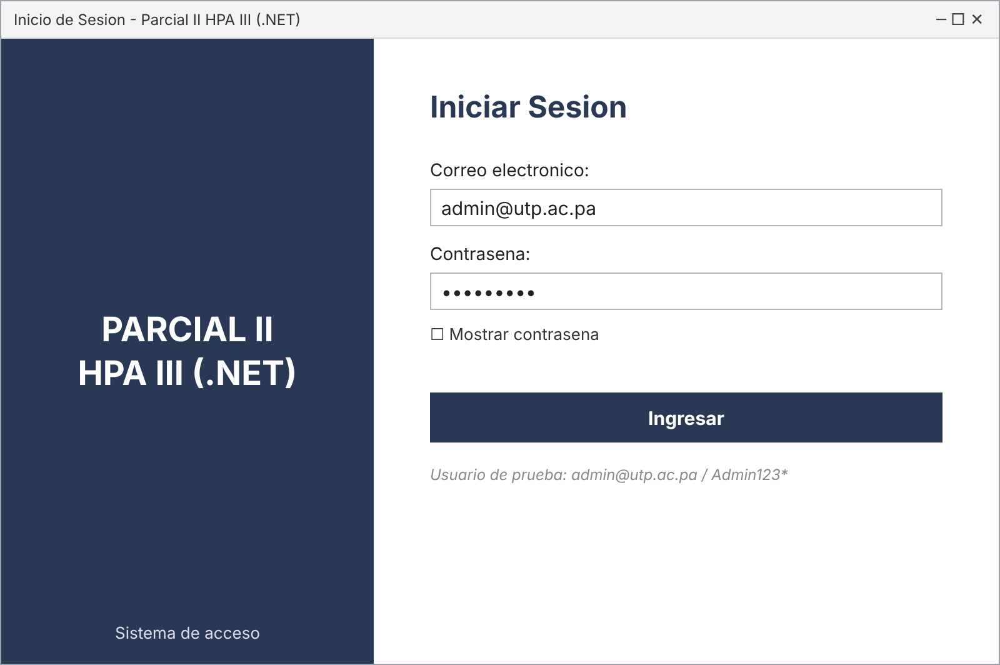
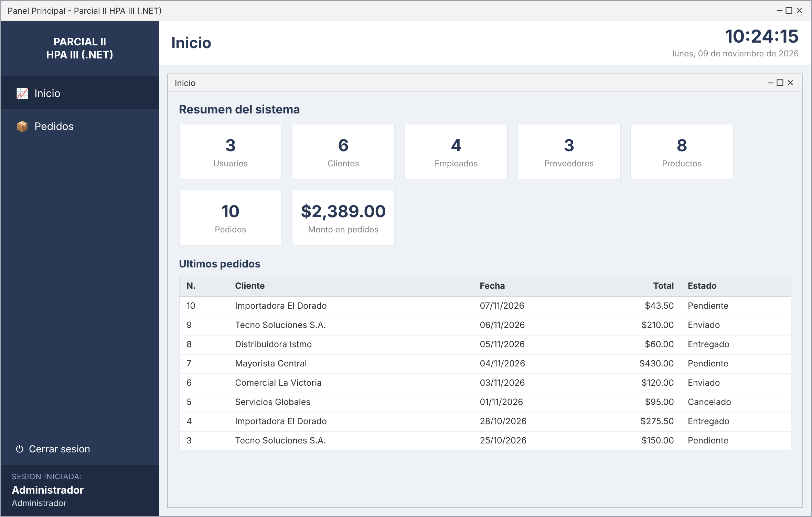
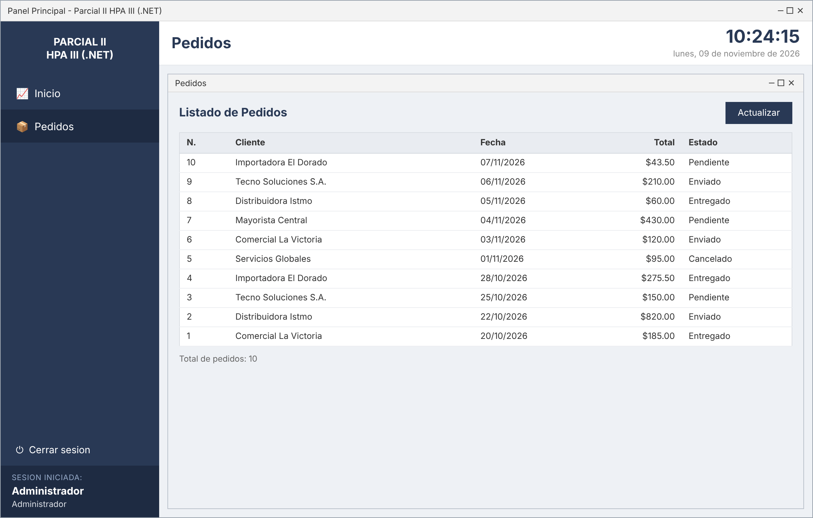

# Parcial 3 — HPA

Repositorio con las tres partes del Parcial 3. Cada parte es una solución de Visual Studio independiente (`.slnx`) escrita en C#.

| Carpeta | Tema | Tipo de proyecto | Framework |
|---|---|---|---|
| [`Parcial3-Parte1`](Parcial3-Parte1) | Herencia y polimorfismo con figuras geométricas | Aplicación de consola | .NET 10 |
| [`Parcial3-Parte 2`](<Parcial3-Parte 2>) | Serialización a JSON con un paquete NuGet | Aplicación de consola | .NET 10 |
| [`Parcial3-Parte3`](Parcial3-Parte3) | Sistema de login y tablero por capas (MVP + MySQL + BCrypt) | Windows Forms | .NET Framework 4.7.2 |

```
Parcial 3 HPA/
├── Parcial3-Parte1/          # Figuras geométricas (POO)
├── Parcial3-Parte 2/         # Newtonsoft.Json
└── Parcial3-Parte3/          # App de escritorio por capas
    ├── Capturas/             # Imágenes de la interfaz
    └── Parcial2HPACapas/     # Código fuente + scripts SQL
```

---

## Parte 1 — Figuras geométricas (herencia y polimorfismo)

**Ruta:** `Parcial3-Parte1/Parcial2-Parte1/`

Programa de consola que muestra los conceptos de programación orientada a objetos:

- **`Figura`** es la clase base, con los métodos virtuales `calcularArea()` y `calcularPerimetro()`.
- **`Cuadrado`**, **`Rectangulo`** y **`Triangulo`** heredan de `Figura` y sobrescriben (`override`) esos métodos con su fórmula propia.
- **`TrianguloTipo`** es un `enum` (`Equilatero`, `Isosceles`, `Escaleno`); el perímetro del triángulo cambia según el tipo.

En `Program.cs` se crea un arreglo `Figura[]` con varias figuras y se recorre llamando a los mismos métodos sobre cada una: el resultado depende del tipo real del objeto (polimorfismo). Para los triángulos se usa `is` y un cast para mostrar también su tipo.

**Ejecutar:**

```bash
cd Parcial3-Parte1/Parcial2-Parte1
dotnet run
```

Salida de ejemplo:

```
Figura 4: Cuadrado
Área: 25
Perímetro: 20
```

---

## Parte 2 — Serialización JSON con Newtonsoft.Json

**Ruta:** `Parcial3-Parte 2/Parcial2-Parte 2/`

Programa de consola que muestra cómo usar una librería externa instalada con NuGet (`Newtonsoft.Json` 13.0.4).

Se crea un objeto anónimo con los datos de una persona (`Nombre`, `Edad`, `Carrera`), se convierte a texto JSON con `JsonConvert.SerializeObject` y se imprime en consola.

**Ejecutar:**

```bash
cd "Parcial3-Parte 2/Parcial2-Parte 2"
dotnet run
```

Salida:

```json
{"Nombre":"Cristell","Edad":"20","Carrera":"Ingenieria en Sistemas"}
```

---

## Parte 3 — Sistema por capas con login seguro (Windows Forms + MySQL)

**Ruta:** `Parcial3-Parte3/Parcial2HPACapas/`

Aplicación de escritorio con inicio de sesión, ventana principal MDI, tablero de resumen y módulo de pedidos. Está organizada en capas y usa el patrón **MVP (Modelo-Vista-Presentador)**.

### Arquitectura

| Capa | Carpeta | Responsabilidad |
|---|---|---|
| **Entidades** | `Entidades/` | Clases de datos: `Usuario`, `Pedido`, `ResumenDashboard`, `Sesion`, `ResultadoHash`. |
| **Datos** | `Datos/` | Acceso a MySQL. `ConexionBD` lee la cadena de conexión de `App.config`; los repositorios (`UsuarioRepositorio`, `PedidoRepositorio`, `DashboardRepositorio`) solo llaman a procedimientos almacenados. |
| **Negocio** | `Negocio/` | Reglas y validaciones: `AutenticacionService`, `PedidoService`, `DashboardService` y el servicio de hashing. |
| **Vista** | `Vista/` | Formularios (`Formularios/`), interfaces de cada vista (`Contratos/`) y presentadores (`Presentadores/`) que conectan la vista con el negocio. |

Flujo: `FrmLogin` → `LoginPresentador` → `AutenticacionService` → `UsuarioRepositorio` → procedimiento almacenado en MySQL.

### Seguridad

- **Contraseñas con BCrypt** (`BCrypt.Net-Next`, factor de trabajo 11). Nunca se guarda la contraseña en texto plano.
- **Dos contratos separados** para el hashing: `IHashService` (generar) e `IVerificarHashService` (verificar). `BCryptHashService` implementa ambos, así que se puede cambiar el algoritmo sin tocar la vista ni los presentadores.
- **Mensajes genéricos** en el login (“Correo o contraseña incorrectos”) para no revelar si un correo existe.
- **Historial de inicios de sesión**: cada intento, exitoso o fallido, se guarda en `login_historial` con fecha, IP local y motivo.
- **Usuario de BD con privilegios mínimos**: la aplicación se conecta como `app_hpa`, que solo tiene permiso `EXECUTE` sobre los procedimientos almacenados y no puede leer ni modificar las tablas directamente.

### Interfaz

- **Login** con validación de campos vacíos.
- **Ventana principal MDI** con menú lateral, reloj arriba a la derecha y el usuario conectado abajo.
- **Inicio (tablero)** con tarjetas de totales (usuarios, clientes, empleados, proveedores, productos, pedidos y monto total) y los últimos pedidos.
- **Pedidos**: listado completo en una grilla.

Las imágenes están en [`Parcial3-Parte3/Capturas/`](Parcial3-Parte3/Capturas):

| Login | Ventana principal | Pedidos |
|---|---|---|
|  |  |  |

### Base de datos

Los scripts están en `Parcial3-Parte3/Parcial2HPACapas/Database/` y se ejecutan **en orden** con un usuario administrador de MySQL (por ejemplo `root`):

1. `01_crear_base_datos.sql` — crea la base `parcial2_hpa3`.
2. `02_crear_tablas.sql` — crea `usuarios`, `clientes`, `empleados`, `proveedores`, `productos`, `pedidos` y `login_historial`.
3. `03_procedimientos_almacenados.sql` — crea los procedimientos `sp_*` que usa la aplicación.
4. `04_datos_iniciales_mock.sql` — carga datos de prueba.
5. `05_crear_usuario_privilegios_minimos.sql` — crea el usuario `app_hpa` y le da permiso solo sobre los procedimientos.

**Usuarios de prueba:**

| Correo | Contraseña | Rol |
|---|---|---|
| `admin@utp.ac.pa` | `Admin123*` | Administrador |
| `usuario@utp.ac.pa` | `Usuario123*` | Usuario |
| `invitado@utp.ac.pa` | `Invitado123*` | Invitado |

### Ejecutar

Requisitos: Windows, Visual Studio con soporte para .NET Framework 4.7.2 y un servidor MySQL 8.

1. Ejecutar los cinco scripts SQL en orden.
2. Si tu servidor, puerto o contraseña son distintos, editar la cadena `ConexionMySql` en `App.config`. La clave de `app_hpa` debe coincidir con la del script 05.
3. Abrir `Parcial3-Parte3/Parcial2HPACapas.slnx` en Visual Studio. Los paquetes NuGet (`MySql.Data`, `BCrypt.Net-Next`, `SSH.NET`) se restauran solos.
4. Compilar y ejecutar (F5). La aplicación arranca en el formulario de login.

> Las contraseñas de `App.config` y del script 05 son solo para pruebas locales. Cámbialas en cualquier otro entorno.
